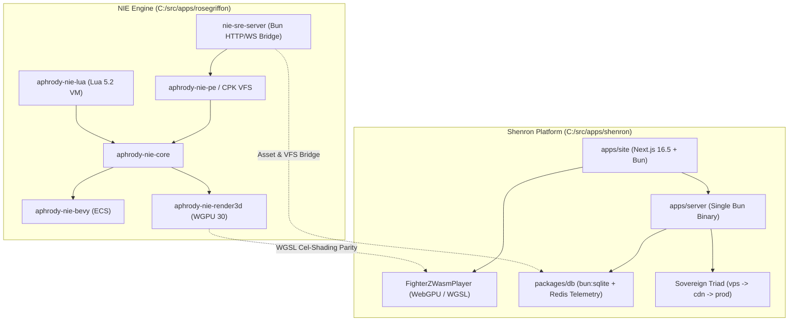

# Architectural & Deployment Comparison: NIE vs Shenron Game Runtime

This document provides a comparative analysis of the architecture, game runtimes, reverse-engineering pipelines, and deployment systems between **NIE** (`C:\src\apps\rosegriffon`) and **Shenron** (`C:\src\apps\shenron`), establishing a convergence roadmap.

---

## 1. Executive Topology Matrix

| Dimension | NIE (`C:\src\apps\rosegriffon`) | Shenron (`C:\src\apps\shenron`) |
| :--- | :--- | :--- |
| **Primary Domain** | Game engine exploration, deep reverse-engineering (IEVR / CPK / Steam), 3D world engine | Sovereign Dragon Ball portal, encyclopedia, streaming engine, WebGPU mini-games, manga OCR |
| **Runtime Core** | Rust 2024 (`aphrody-nie-*`) + Bun v1.4.4 (`nie-sre-server.ts`) | Upstream Bun v1.4.4 + Next.js 16.5 standalone + Rust 2024 (`crates/*`) |
| **Graphics Engine** | WGPU 30, Vello, Bevy ECS (`aphrody-nie-bevy`), Softraster fallback | WebGPU native WGSL Cel-Shader (`FighterZWasmPlayer`), Canvas 2D/3D ECS, CSS-first Tailwind v4 |
| **RE & Asset Pipeline** | CPK Virtual File System (`aphrody-nie-pe`), Ghidra Sleigh, Magika ML | Depot RE Engine (`depot-cli`), UE4 Pak reader, `bun:sqlite` + Redis telemetry |
| **Target Game Systems** | INAZUMA ELEVEN: Victory Road, Steamworks P2P, Lua 5.2 VM | DRAGON BALL FighterZ, Sparking! ZERO, Xenoverse 2, RetroArch DB games |
| **Deployment Model** | Micro-SRE bridge (`deploy/nie-sre`, HTTP/WS port 8899, systemd) | Sovereign Fleet Triad (`vps`/`cdn`/`prod`), Zstd streaming, Docker BuildKit, zero-downtime lanes |

---

## 2. Engine & Runtime Architectural Deep-Dive

### NIE: Rust-Centric Native World Engine
NIE is architected as a modular cluster of 45+ specialized Rust crates operating around `aphrody-nie-core` and `aphrody-nie-render3d`:

#### NIE Key Architectural Advantages:
1. **Low-Level Hardware Access**: Direct integration with NVIDIA Ada Lovelace `sm_89` via WGPU 30 and CUDA 13.4.
2. **Deep File Format Triage**: Native CPK container extraction, Magika content typing, and disassembly through `depot-re` / `iced-x86`.
3. **Lua 5.2 Runtime**: Native embedded Lua 5.2 execution with PUC-Rio specifications (`_ENV` lexical scoping, 40 opcodes).

### Shenron: Web-Scale Sovereign Platform
Shenron prioritizes instantaneous web delivery, zero client-side installation, and rich multimedia presentation:

#### Shenron Key Architectural Advantages:
1. **Zero-Friction In-Browser Gaming**: Users launch WebGPU 60/120 FPS games directly within `apps/site` with Gamescope telemetry overlays.
2. **Deterministic Autonomous Deployment**: Lane-based zero-downtime updates with automated rollbacks and Docker cache mounts.
3. **Rich Relational & Cache Data**: PostgreSQL with RLS, resilient Redis clustering, and local fast-read `bun:sqlite` databases.

---

## 3. SRE & Deployment System Comparison

### NIE Deployment Architecture (`deploy/nie-sre`)
- **Topology**: Lightweight service daemon (`nie-sre-server.ts`) exposed over port 8899.
- **Service Endpoints**:
  - `GET /health` & `GET /status`: System telemetry and loaded engine subsystems.
  - `GET /vfs/list` & `POST /vfs/read`: Zero-copy byte range extraction from game archives.
  - `POST /rea/classify`: Magika / heuristic format classification.
  - `POST /stream/frame` & `GET /stream/live`: Real-time browser frame streaming.
- **Process Supervision**: Systemd unit (`nie-sre.service`) and Docker Compose containerization.

### Shenron Deployment Architecture (`scripts/deploy`)
- **Topology**: Sovereign 3-Node WireGuard Mesh (`10.200.77.0/24`):
  - **`vps` (`10.200.77.1`)**: 12-core compilation farm and Docker BuildKit caching.
  - **`cdn` (`10.200.77.3`)**: Cloudflare edge simulator (Pingora Gateway, Garage S3, RQLite D1).
  - **`prod` (`10.200.77.5`)**: Arch Linux bare-metal node running Shenron microservices.
- **Image Pipeline**: `release.sh` builds images on `vps` and streams compressed layers via `zstd -T0` over WireGuard directly into `prod`'s Docker daemon.
- **Service Activation**: Autonomous lane updates via `scripts/deploy/lanes.ts` (`docker compose up -d --no-deps --no-recreate <service>`).

---

## 4. Convergence & Modernization Roadmap

To unify the strengths of NIE and Shenron without code duplication or architectural drift:

1. **Telemetry & RE Engine Unification**:
   - Both platforms use `C:\src\crates\depot` (`depot-cli`) as the canonical binary triage and AST engine.
   - Shenron's `packages/db/src/re-telemetry.ts` serves as the centralized SQLite/Redis telemetry store for all game assets.
2. **WebGPU Shader Sharing**:
   - The ArcSys cel-shading pipeline documented in `docs/games/dbfz-modding-ecosystem.md` is standardized into WGSL shaders shared across `FighterZWasmPlayer` and NIE's browser viewport.
3. **Deployment Bridge**:
   - NIE's `nie-sre-server.ts` is configured as an upstream microservice in Shenron's production mesh, allowing Shenron's web portal to query live VFS data and game frames directly.
