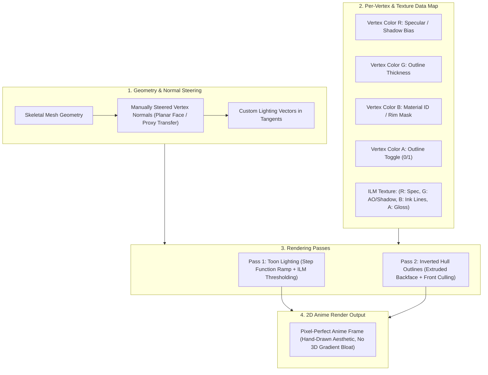

# Dragon Ball FighterZ: Modding Ecosystem, Toolchain & RED Engine Architecture

This document synthesizes the authoritative specifications, toolchain, shader pipeline, networking stack, and package mounting architecture for **Dragon Ball FighterZ** (Arc System Works RED Engine / customized Unreal Engine 4.17.2).

---

## 1. Unreal Engine 4 Modding Toolchain

The Dragon Ball FighterZ modding ecosystem relies on specialized Unreal Engine 4 community tooling adapted to UE 4.17.2 and ArcSys proprietary binary structures.

### Toolchain Inventory

| Tool                 | Role                                            | Target DBFZ Domain                                                       | Input / Output Formats                                          |
| :------------------- | :---------------------------------------------- | :----------------------------------------------------------------------- | :-------------------------------------------------------------- |
| **FModel**           | Asset decompiler, VFS explorer, asset extractor | Exploration of `RED/Content/Paks`, audio cues, mesh / texture inspection | `.pak` -> `.uasset`, `.uexp`, `.ubulk`, `.png`, `.tga`, `.gltf` |
| **UAssetGUI**        | Low-level binary property and datatable editor  | Character attributes, hitboxes, UI mappings, material parameters         | `.uasset` + `.uexp` <-> `.json`                                 |
| **UnrealPak**        | UE4 Pak archive packager (UE 4.17 build)        | Packaging mod staging folders into game-mountable patch paks             | Directory tree -> `.pak` (Version 4, Zlib compression)          |
| **Unverum**          | Modern GUI Mod Manager & EAC bypass loader      | Dependency management, profile switching, GameBanana integration         | `.pak` deployment to `~mods/`, launch argument injection        |
| **DBFZ Mod Manager** | Legacy package manager and batch runner         | Batch loading of loose archives and mod conflict resolution              | Legacy mod `.pak` injection                                     |

### Toolchain Workflows & Specifications

#### FModel Configuration

- **Engine Version**: Unreal Engine 4.17 (`GAME_UE4_17`).
- **Archive Path**: `<InstallRoot>/RED/Content/Paks/`.
- **Encryption / AES Key**: Shipping packages (`pakchunk0`, `pakchunk1`) use unencrypted indexes or standard public keys; no custom AES passphrase is required for reading standard retail game paks.
- **Key Internal Namespaces**:
  - `RED/Content/Chara/<ID>/`: Character skeletal meshes, physics assets, animation sequences, material instances, and ILM textures (e.g., `GKN` = Goku Normal, `VTB` = Vegeta Super Saiyan Blue, `HIT` = Hit, `BRL` = Broly).
  - `RED/Content/Stage/<ID>/`: Battle stage geometry, skyboxes, dynamic stage transition logic.
  - `RED/Content/UI/`: Character selection portraits, HUD elements, gauge bars, localization textures.
  - `RED/Content/Sound/`: CriWare / Wwise sound banks, BGM cues, character battle voice lines.

#### UAssetGUI Binary Editing

- Opens serialized `.uasset` and companion `.uexp` export files directly without requiring a full Unreal Editor project compilation.
- Exposes:
  - `NameMap`, `ImportMap`, `ExportMap` tables.
  - Serialized struct and property fields (`FProperty`, `UDataTable`, `UMaterialInstanceConstant`).
- Provides lossless JSON serialization:
  ```sh
  # CLI JSON round-trip for automated scripted pipelines
  UAssetGUI.exe to-json "Character_Param.uasset" "Character_Param.json"
  UAssetGUI.exe from-json "Character_Param.json" "Character_Param.uasset"
  ```

#### UnrealPak Packaging Protocol

- Must use the `UnrealPak.exe` binary built for Unreal Engine 4.17 (Pak file version 4).
- Requires exact mount point mapping in the response file to match the VFS root (`../../../RED/Content/`):
  ```text
  # responsefile.txt
  "C:\Workspace\DBFZMod\RED\Content\Chara\GKN\GKN_Color01.uasset" "../../../RED/Content/Chara/GKN/GKN_Color01.uasset"
  "C:\Workspace\DBFZMod\RED\Content\Chara\GKN\GKN_Color01.uexp" "../../../RED/Content/Chara/GKN/GKN_Color01.uexp"
  ```
- Command execution:
  ```powershell
  UnrealPak.exe "C:\Mods\pakchunk99-GokuSkin_P.pak" -create="responsefile.txt" -compress -compressionformats=Zlib
  ```

---

## 2. ArcSys Cel-Shading & Anime Shader Pipeline (RED Engine)

Arc System Works' proprietary cel-shading pipeline achieves a hand-drawn 2D anime appearance in full 3D through five interlocking technical systems:



### 1. Vertex Normal Steering (Custom Normals)

- **Problem**: Standard vertex normals computed from spherical or curved facial geometry cause smooth gradient lighting, creating unwanted 3D curvature shadows around cheeks, eye sockets, and noses.
- **Solution**:
  - Artists in 3ds Max / Maya manually edit vertex normal orientations.
  - Facial normals are planarized or transferred from flat projection plates or cylindrical proxies.
  - When the character turns toward or away from the light source, the shadow boundary sweeps across the face as a flat, crisp 2D line rather than a round gradient.
- **Tangent Packing**: The secondary anime lighting direction is encoded into mesh tangent vectors to decouple engine-native geometry calculations from stylized cel calculations.

### 2. Light Ramp & Step Functions

- Standard Lambertian falloff ($N \cdot L = \cos\theta$) is replaced by a quantized threshold ramp:
  $$\text{ToonFactor} = \begin{cases} 1.0 & \text{if } (N \cdot L + \text{Bias}) > \text{Threshold} \\ \text{ShadowFactor} & \text{otherwise} \end{cases}$$
- Shadow transitions are defined either via a 1D ramp texture or via discrete step levels (Lit, Half-Shadow, Ambient Shadow).
- Cast shadows are clamped to prevent noisy inter-object shadowing.

### 3. Per-Vertex Color Channel Map (RGBA)

| Vertex Color Channel | Shader Parameter        | Functional Behavior                                                                                                                   |
| :------------------- | :---------------------- | :------------------------------------------------------------------------------------------------------------------------------------ |
| **Red (R)**          | Specular / Shadow Bias  | Modulates the threshold where shadows begin on specific parts of the geometry.                                                        |
| **Green (G)**        | Outline Line Weight     | Controls local line thickness during backface extrusion (thick on clothing/muscles, thin on fingers).                                 |
| **Blue (B)**         | Material / Rim Mask     | Distinguishes material types (skin, cloth, metal) and scales secondary rim-light effects.                                             |
| **Alpha (A)**        | Outline Visibility Flag | Binary or scalar toggle for outlines (`0.0` = completely disabled, eliminating interior seams on mouth/eyes; `1.0` = fully rendered). |

### 4. ArcSys ILM Texture Format

In addition to the BaseColor (`_Color`) diffuse texture, every character material utilizes an **ILM map** (`_ILM`):

- **Channel R (Red)**: Specular intensity / metallic reflectivity mask.
- **Channel G (Green)**: Permanent ambient occlusion and light ramp shift. Forces clothes folds and under-jaw regions into perpetual shadow.
- **Channel B (Blue)**: Fine inner manga line art (static ink lines painted directly onto the texture surface).
- **Channel A (Alpha)**: Specular exponent / glossiness factor and outline tint weight.

### 5. Inverted Hull Outlines (Extruded Backface)

- Unlike screen-space post-processing edge detection (e.g. Sobel / depth-normal edge filters), ArcSys uses a pure geometric two-pass approach:
  - **Pass 1**: The character mesh is rasterized with standard backface culling (`Cull Back`) and cel-shaded materials.
  - **Pass 2**: The vertex shader extrudes each vertex outward along its vertex normal:
    $$P_{\text{outline}} = P + N \times (\text{BaseThickness} \times \text{VertexColor.G} \times \text{VertexColor.A} \times \text{DepthScale})$$
  - Rasterizer State: **Front-face culling** (`Cull Front`) is activated so only the extruded back faces remain visible around the silhouette.
  - Pixel Shader: Outputs an unlit flat color (dark brown or localized hue-shifted ink color).
- **Advantage**: Outlines remain stable under high-speed camera rotation and dramatic super moves, completely free of temporal aliasing or screen-space depth flickering.

---

## 3. Official Networking, Matchmaking & SDK Boundaries

### Architecture Matrix

| Component                   | Target Binary / Service                       | SDK Version                         | Function & Responsibility                                                                             |
| :-------------------------- | :-------------------------------------------- | :---------------------------------- | :---------------------------------------------------------------------------------------------------- |
| **Steamworks**              | `steam_api64.dll`                             | v1.41                               | User authentication (`ISteamUser`), Steam P2P sessions (`ISteamNetworking`), achievements, cloud sync |
| **Lobby & Matchmaking**     | ArcSys Game Servers + Steam Matchmaking       | Custom ArcSys RED Protocol          | 64-player World Tour interactive lobbies, Ring Matches, Arena Matches, Ranked ladders                 |
| **Anti-Cheat Watchdog**     | `EasyAntiCheat_x64.dll` + `EasyAntiCheat.sys` | Epic Games EAC (EOS)                | Process memory protection, binary hook detection, pak hash signature validation                       |
| **Rollback Netcode Engine** | `RED-Win64-Shipping.exe`                      | ArcSys In-House GGPO Implementation | Deterministic game-state rollback, frame prediction, input history buffers                            |
| **Epic Online Services**    | EOS Backend Bridge                            | EOS SDK (Patch 1.34+)               | Cross-platform relay, match routing, backend authentication synchronization                           |

### Matchmaking & Network Topology

- **World Tour Lobbies**: 64-player interactive physical lobbies where players move chibi avatars and interact with stations (Ring Match, Arena, Replay Theater, Shop).
- **Match Gameplay Networking**:
  - Initially shipped with Steam P2P delay-based netcode using `steam_api64.dll` v1.41.
  - **Rollback Netcode Update (v1.34+, Feb 2024)**: Replaced delay-based networking with a high-performance rollback netcode engine.
  - The rollback architecture maintains a circular buffer of frame inputs (up to 7 frames of rollback simulation) and serializes full battle game-state snapshots every frame.
  - If a packet arrives with earlier remote inputs, the engine rolls back the game state to the divergence frame, applies inputs, and re-simulates physics/frame logic up to the current frame within a sub-millisecond CPU budget.

### Anti-Cheat Boundaries & Mod Execution Protocol

- **EAC Signature Verification**:
  - `EasyAntiCheat_x64.dll` validates the digital integrity of the executable and Pak archive headers.
  - Unsigned `.pak` archives loaded into memory trigger an EAC violation, terminating the process or revoking online lobby access.
- **Modded Launch Strategy**:
  - To execute mods, EAC must be bypassed by either:
    1. Launching `RED\Binaries\Win64\RED-Win64-Shipping.exe` directly (bypassing the EAC wrapper executable `DBFighterZ.exe`).
    2. Adding launch parameter `-eac-nop-loaded` via Steam properties or a community loader (e.g. Unverum).
  - **Operational Constraint**: When EAC is disabled, official online matchmaking and ranked servers are inaccessible. Modded play is restricted to offline local modes, training, and direct private P2P sessions between matching mod setups.

---

## 4. UE4.17 Pak Chunk Structure & `~mods` Architecture

### Pak Layout Specifications

Files are located at `<GameRoot>\RED\Content\Paks\`:

| Container Name                  | Size     | Pak Version  | Magic Header | Content Scope                                                                                      |
| :------------------------------ | :------- | :----------- | :----------- | :------------------------------------------------------------------------------------------------- |
| `pakchunk0-WindowsNoEditor.pak` | ~5.04 GB | v4 (UE 4.17) | `0x5A6F12E1` | Core engine runtime, common shaders, UI widgets, base character roster models, default sound banks |
| `pakchunk1-WindowsNoEditor.pak` | ~841 MB  | v4 (UE 4.17) | `0x5A6F12E1` | Post-launch patches, DLC characters (FighterZ Passes 1-3), additional arenas, event assets         |

### Standard Mod Mounting: The `~mods` Directory

- **Path**: `<GameRoot>\RED\Content\Paks\~mods\`
- **Mount Ordering Mechanism**:
  1. Unreal Engine's `FPakPlatformFile::FindPreregisteredPluginPakFiles` scans the `Paks` directory and subdirectories.
  2. Discovered pak files are mounted in strict lexicographical (alphabetical) order by file path.
  3. The tilde character `~` has ASCII hexadecimal value `0x7E`, which ranks higher than alphanumeric characters (`0-9` = `0x30-0x39`, `A-Z` = `0x41-0x5A`, `a-z` = `0x61-0x7A`).
  4. Any pak residing inside `~mods/` is registered _after_ root directory containers (`pakchunk0` and `pakchunk1`).

### Virtual File System (VFS) Precedence

- **Mount Point**: All official and modded paks share the identical root mount point:
  `../../../RED/Content/`
- When multiple pak archives contain the same virtual path (e.g., `../../../RED/Content/Chara/GKN/GKN_00_Texture.uasset`), UE4's VFS resolves asset requests using the last-mounted archive.
- **The Patch Suffix (`_P`)**:
  - Mod authors follow the Unreal naming convention of appending `_P` (or `_99_P`) to mod archives (e.g., `pakchunk99-VegitoCostume_P.pak`).
  - Unreal Engine's pak reader identifies the `_P` suffix as an official patch chunk, granting it higher priority in index lookups.

---

## 5. WebGPU Anime Shader Mapping for Shenron

Shenron's WebGPU engine (`packages/engine` & `apps/site/src/components/games/FighterZWasmPlayer.tsx`) maps ArcSys UE4 parameters directly into WebGPU / WGSL:

```wgsl
struct VertexInput {
  @location(0) position: vec3<f32>,
  @location(1) normal: vec3<f32>,
  @location(2) uv: vec2<f32>,
  @location(3) color: vec4<f32>, // RGBA vertex color
};

struct VertexOutput {
  @builtin(position) position: vec4<f32>,
  @location(0) normal: vec3<f32>,
  @location(1) uv: vec2<f32>,
  @location(2) vColor: vec4<f32>,
  @location(3) worldPos: vec3<f32>,
};

// Cel-Shading Fragment Stage
@fragment
fn fs_main(in: VertexOutput) -> @location(0) vec4<f32> {
  let lightDir = normalize(vec3<f32>(0.5, 0.8, 0.4));
  let NdotL = dot(normalize(in.normal), lightDir);
  
  // Apply ArcSys Vertex Color Shadow Bias (Channel R)
  let biasedNdotL = NdotL + (in.vColor.r * 0.2 - 0.1);
  
  // 2-tone hard light ramp
  let toonFactor = select(0.35, 1.0, biasedNdotL > 0.0);
  
  let baseColor = vec3<f32>(0.92, 0.45, 0.15); // Goku Gi Orange
  return vec4<f32>(baseColor * toonFactor, 1.0);
}
```
