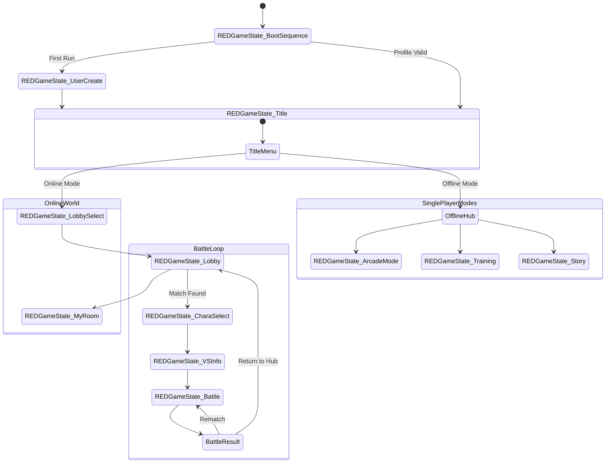

# Dragon Ball Modern Games Architecture & Manifest Specification

## 1. Executive Summary & Purpose

This document provides a canonical specification of modern Dragon Ball games based on binary inspection, reverse engineering, and asset layout analysis of *DRAGON BALL FighterZ* (Bandai Namco Entertainment / Arc System Works), with direct architectural cross-applicability to *DRAGON BALL Xenoverse 2* (Dimps), *DRAGON BALL Z: Kakarot* (CyberConnect2), and *DRAGON BALL: Sparking! ZERO* (Spike Chunsoft).

Modern Dragon Ball games share standard architectural tiers:
1. **Engine Layer**: Unreal Engine 4/5 or custom proprietary engines (e.g. Dimps Havok-integrated engine), containerized with signature `.pak` / `.sig` chunking.
2. **Deterministic Battle Subsystem (ASW / RED Engine)**: Pure fixed-point simulation decoupled from visual rendering framerate, driven by scriptable frame-by-frame action machines (`Actsub` / `ObjectManager`).
3. **Anti-Cheat & Execution Harness**: EasyAntiCheat (EAC) launcher wrapper with P2P anti-tamper modules (`EasyAntiCheatP2P`).
4. **Platform & Netcode Layer**:
   - Web API Tier (`TLGameServer` / Bandai Namco Channel HTTP/REST).
   - Peer-to-Peer / Lobby Transport (`mnp` - Multi Network Platform via Steamworks / PSN / Xbox Live / Switch / WeGame).
   - Deterministic Rollback Netcode (`REDGGPO` / `GGPOUE4`).

---

## 2. Target Manifest & Binary Topology

### 2.1 File System & Package Manifest (DRAGON BALL FighterZ Target)
```
DRAGON BALL FighterZ/
├── DBFighterZ.exe                      # EasyAntiCheat Launcher (eac_launcher.exe v1.0.0.0, 1,518,192 bytes)
├── installscript.vdf                   # Steam DirectSetup & redistributable invocation
├── EasyAntiCheat/
│   ├── EasyAntiCheat_Setup.exe         # Service installer
│   ├── EasyAntiCheat_x64.dll           # 64-bit runtime driver bridge
│   ├── EasyAntiCheat_x86.dll           # 32-bit runtime driver bridge
│   ├── Certificates/
│   │   ├── game.bin                    # Signed integrity payload
│   │   └── game.cer                    # X.509 signature verification certificate
│   └── Launcher/
│       ├── Settings.json               # EAC bootstrap config
│       └── SplashScreen.png            # EAC startup splash
├── Engine/                             # Unreal Engine 4.17.2 Runtime Core
│   ├── Binaries/ThirdParty/            # NVaftermath, PhysX/Apex, Steamworks (v141), Ogg/Vorbis, WeGame
│   └── Extras/Redist/en-us/            # UE4PrereqSetup_x64.exe
└── RED/                                # Game Project ('RED' - Arc System Works DBFZ Codename)
    ├── Binaries/Win64/
    │   ├── RED-Win64-Shipping.exe      # Main Game Binary (UE4.17.2-Shipping, 184,261,120 bytes)
    │   └── steam_appid.txt             # Steam AppID: 678950
    └── Content/
        ├── Movies/                     # Bink/MP4 Video cutscenes (mv_opening_*, mv_storyop_*)
        └── Paks/
            ├── pakchunk0-WindowsNoEditor.pak  # 5,414,923,132 bytes (Core assets, models, sounds)
            ├── pakchunk0-WindowsNoEditor.sig  # 330,572 bytes (Signature hash)
            ├── pakchunk1-WindowsNoEditor.pak  # 881,949,120 bytes (DLC & post-launch assets)
            └── pakchunk1-WindowsNoEditor.sig  # 53,900 bytes (Signature hash)
```

### 2.2 EAC Launcher Bootstrap (`Settings.json`)
The primary executable exposed to Steam is a protective launcher shim:
```json
{
  "title": "DRAGON BALL FighterZ",
  "executable": "RED\\Binaries\\Win64\\RED-Win64-Shipping.exe",
  "logo_position": "bottom-left",
  "parameters": "",
  "use_cmdline_parameters": "1",
  "working_directory": "",
  "wait_for_game_process_exit": "0",
  "hide_splash_screen": "0",
  "hide_ui_controls": "0"
}
```

### 2.3 Package Archive Specification (`.pak` Format)
- **Container Magic**: `0x5A6F12E1` (Unreal Engine Pak Magic) stored at EOF footer.
- **Index Header**: Offset stored in trailing 204-byte metadata footer with SHA-1 hash table.
- **Compression**: Zlib / Oodle block compression (chunk size 64KB).
- **Mount Points**: Standard virtual mounting points relative to `/RED/Content/`.

---

## 3. Game State Machine (`REDGameState`)

Arc System Works implements game state management via a centralized hierarchical `REDGameState` hierarchy within UE4:



### Key State Classes:
- `REDGameState_BootSequence`: Cold boot initialization, EULA check (`REDEULAMenu`), Steam / platform auth handshake.
- `REDGameState_UserCreate`: New profile generation and R-Code setup.
- `REDGameState_LobbySelect`: Region/area query and server room selection.
- `REDGameState_Lobby`: 64-player interactive lobby avatar world.
- `REDGameState_CharaSelect` / `REDGameState_CharaSelect_S3`: Character, assist type, and stage selection.
- `REDGameState_VSInfo`: Pre-battle face-off, card title presentation, loading synchronization.
- `REDGameState_Battle`: Active deterministic battle loop.
- `REDGameState_ArcadeMode`: Arcade ladder scoring and progression.
- `REDGameState_ReplayTest`: Deterministic replay validation.

---

## 4. Deterministic Battle Engine Architecture (`ASW::Game::Battle`)

The core battle system runs independently of the Unreal Engine rendering pipeline. The simulation advances at a strict 60Hz tick rate:

### 4.1 Core Subsystems
- **`battle_ObjectManager`**: Manages all active battle instances, character objects, assists, projectiles, particle emitters, and collision hulls.
- **`char_Actsub`**: Frame-by-frame script execution machine for character states.
- **`BattleEventManager`**: Dispatches system-level events (Super Dash, Sparking Blast, Z Reflect, Dramatic Finish).

### 4.2 Script & Action Machine Instruction Set
Characters are programmed using Arc System Works bytecode commands:
- **Conditionals & Flags**: `ifcommon`, `iflocal`, `ifvalue`, `ifbattle`, `ifnormalflag`, `ifsystemflag`, `ifmember`.
- **State Setting**: `normalflag_setting`, `systemflag_setting`, `valueflag_setting`.
- **Hit & Guard Properties**:
  - `GUARD`, `IN_GUARD`, `GUARD_LATER`, `REFLECT`
  - `COUNTER_HIT`, `TAKE_COUNTER_HIT`, `CLASH`
  - `STAND`, `CROUCH`, `JUMP`, `LANDING`
  - `ARC_BTL_SYS_AssistAct`, `ARC_BTL_SYS_AssistReady`, `ARC_BTL_SYS_GuardCancel`
- **Dramatic Sequences**: `Hakai`, `BodyChange`, `Kyukyoku_Kamehameha`, `FinalFlashAttack`, `CoupleDance`.

---

## 5. Modern Dragon Ball Games Standard Specification Matrix

| Layer | DRAGON BALL FighterZ | DRAGON BALL Xenoverse 2 | DRAGON BALL Z: Kakarot | DRAGON BALL: Sparking! ZERO |
|---|---|---|---|---|
| **Engine** | Unreal Engine 4.17.2 | Custom Dimps Engine | Unreal Engine 4.21+ | Unreal Engine 5.3+ |
| **Developer** | Arc System Works | Dimps | CyberConnect2 | Spike Chunsoft |
| **Battle Type** | 3v3 2.5D Tag Fighter | 3D Arena Brawler / RPG | Action RPG / Free Roam | 3D Budokai Tenkaichi Arena |
| **Netcode Protocol** | Rollback (GGPO) + Steam P2P | Client-Server / UDP Lockstep | None (Single Player offline) | P2P Rollback & Delay Hybrid |
| **Backend REST API** | `TLGameServer` (Bandai Namco) | Dimps Net Server | Bandai Telemetry | Bandai Namco Channel |
| **Anti-Cheat** | EasyAntiCheat (EAC) | EasyAntiCheat (EAC) | None | EasyAntiCheat (EAC) |
| **Asset Packaging** | UE4 `.pak` / `.sig` | `.cpk` (CRIWARE) | UE4 `.pak` / `.sig` | UE5 `.pak` / `.ucas` / `.utoc` |

---

## 6. Implementation Guidelines for Sovereign DB Tools (`shenron`)

1. **Parser Compatibility**: Provide native Bun / Rust tools to inspect UE4/UE5 `.pak` archives without external Python or heavy GUI dependencies.
2. **Protocol Emulation**: Support mock `TLGameServer` endpoints for offline tournament hosting and local network matches.
3. **Replay Format Reconstruction**: Support parsing serialized input streams for automated tournament statistics extraction and match visualization.
