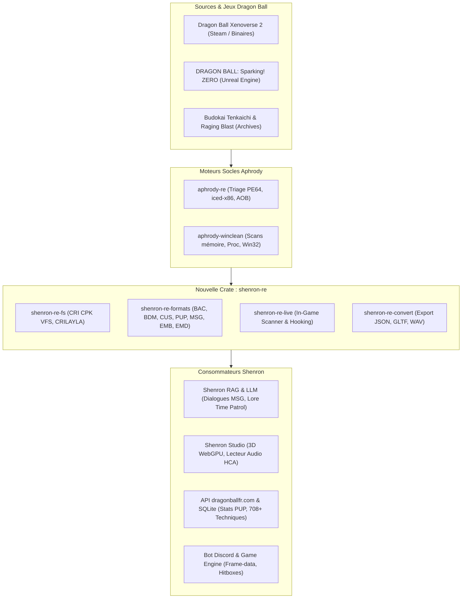
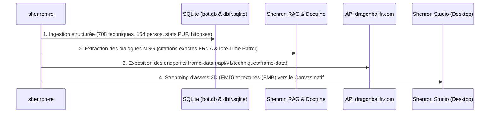

# PLAN : Architecture & Migration de DBXV2 et de l'Écosystème RE Dragon Ball vers `shenron-re` (Rust)

> **Statut** : Approuvé pour conception & cadrage d'ingénierie
> **Cible** : Workspace Shenron (`crates/shenron-re`), pont `aphrody-re` & `winclean`, extraction d'assets et alimentation de l'encyclopédie dragonballfr.com
> **Auteur** : Shenron 🐉 & Omar (`KyrioFox`)
> **Licence & Contrainte** : 100 % Pur Rust, Zéro C/C++ non géré, Zéro GPL viral, Zero-copy parsing (`zerocopy` + `binrw`), compatibilité Windows x86_64 et Linux WSL2.

---

## 1. Vision et Objectifs Stratégiques

L'objectif de ce plan est de concevoir et implémenter la crate unifiée **`shenron-re`** dans le workspace Shenron. Cette crate remplace l'ensemble des outils éparpillés en Python, C++ et C# de la communauté modding par une bibliothèque native Rust ultra-performante et modulaire, unifiant :
1. **L'analyse binaire et forensic** via **`aphrody-re`** (triage PE64, inspection des sections, recherche AOB, désassemblage `iced-x86`).
2. **L'observation et l'extraction mémoire en temps réel** via **`aphrody-winclean`** (scans de mémoire dynamique, suspension sans corruption de page, contournement EAC en mode debug).
3. **Le décodage natif de tous les formats de fichiers Dimps / Dragon Ball Xenoverse 2** (archives CRIWARE CPK, scripts d'animation BAC, matrices de dégâts BDM, compétences CUS, multiplicateurs PUP, modèles EMD/EMB, dialogues MSG).
4. **L'intégration des meilleurs algorithmes RE open-source** de la scène Dragon Ball (Eternity Tools, LibXenoverse, CriPakTools, FModel/UAsset pour Sparking! ZERO).
5. **L'alimentation bout-en-bout de Shenron** : API DBFR, moteur de combat local, encyclopédie web, RAG sans hallucination, et visualiseur 3D / audio dans Shenron Studio.

---

## 2. Décomposition des Modules de `shenron-re`

La crate sera structurée en sous-modules découplés au sein de `crates/shenron-re/` :

### A. `shenron-re-fs` : Système de Fichiers & Archives CRIWARE (Pur Rust)
- **Décodage CPK (`criware_cpk`)** :
  - Parsing de l'en-tête `CPK` et des tables `@UTF` (Unicode Table Format).
  - Décompression ultra-rapide de l'algorithme propriétaire **CRILAYLA** (déjà prototypé en Rust dans l'écosystème CRI sans allocation heap inutile).
  - Gestion des flags de chiffrement et des masques XOR (clés standard Dimps / Bandai Namco).
- **VFS Hybride (Virtual File System)** :
  - Exposition d'un système de fichiers virtuel mémoire permettant à Shenron de lire un asset (ex: `data/chara/GOK/GOK.emb`) directement depuis les archives `.cpk` sans extraction préalable de 30 Go sur le disque dur.

### B. `shenron-re-formats` : Les Formats de Données Métier DBXV2
Migration en Rust typé avec `binrw` et `serde` de tous les formats binaires documentés par Eternity et LibXenoverse :

| Format | Rôle & Description | Données Extraites pour Shenron |
| :--- | :--- | :--- |
| **`CUS`** | *Character Ultimate Skills* | Les 708 compétences, coûts en Ki/Endurance, type (Super, Ultime, Éveil, Évasive). |
| **`CMS`** | *Character Model Spec* | Codes d'identification (ex: `GOK`, `VGT`), chemins de modèles et voix. |
| **`CSO`** | *Character Sound Options* | Correspondance des banques de voix japonaises et bruitages d'effets. |
| **`PSC`** | *Player Status Characteristics* | Statistiques brutes : PV max, vitesse, défense, endurance par forme. |
| **`PUP`** | *Power-Up Parameters* | Multiplicateurs de dégâts exacts lors des transformations (Super Saiyan 1/2/3, Blue, Ultra Instinct). |
| **`BAC`** | *Battle Action Code* | Scripts des coups : timings précis en frames (startup, active, recovery), hitboxes et super-armor. |
| **`BDM`** | *Battle Damage Matrix* | Calculs de dégâts de base, stuns, type de projection physique (knockback/wall-bounce). |
| **`BSA`** | *Battle Sub-Actions* | Spécifications des projectiles (Kamehameha, Genkidama), caméras et séismes. |
| **`MSG`** | *Message Tables (Multilingue)* | Textes, dialogues in-game, noms officiels FR/JA des attaques et descriptifs. |
| **`EMB`** | *Embedded Bitmaps* | Porteurs de textures DDS et portraits de personnages HUD. |
| **`EMD` / `EMG`**| *3D Meshes & Geometry* | Géométrie 3D des personnages, tenues et accessoires pour affichage WebGPU. |
| **`EAN`** | *Embedded Animation* | Données d'animation squelettique (poses Toriyama, postures de combat). |

### C. `shenron-re-live` : Inspection Mémoire & Pont `winclean`
- Intégration de `aphrody-winclean::memory` pour sonder le binaire `DBXV2.exe` en cours d'exécution :
  - **AOB Signatures** : Repérage automatique en mémoire des pointeurs de joueurs, des jauges de Ki, d'Endurance et de vie.
  - **Capture d'état de combat** : Extraction en direct des coordonnées cartésiennes des combattants pour alimenter le visualiseur tactique de Shenron Studio.
  - **Sécurité** : Mode passif `ReadProcessMemory` sans risque d'altération de sauvegarde.

---

## 3. Curation & Fusion des Dépôts Open-Source Dragon Ball RE

Les projets suivants serviront de référence technique et de conversion vers le standard Rust de `shenron-re` :

1. **Eternity Tools (`xv2lib`, `xv2patcher`)** :
   - *Référence C++ incontournable*. La logique de parsing des tables CMS, CUS, PUP et BAC est transcrite en Rust moderne, sans pointeurs bruts non vérifiés.
2. **`libxenoverse` (DarioSamo & communauté)** :
   - Schémas XML et structures de données pour les formats EMD, ESK, EAN et EEPK (système de particules).
3. **`criware-rs` & `CriPakTools`** :
   - Références de décompression CRILAYLA et lecture des flux de conteneurs audio `.acb` / `.awb` (ADX/HCA).
4. **Projets de reverse engineering Budokai Tenkaichi (BT3 / Sparking! ZERO)** :
   - Rapprochement des noms de techniques et des statistiques de puissance d'un jeu à l'autre pour alimenter le comparateur de puissance DBFR.

---

## 4. Alimentation Complète de l'Écosystème Shenron

Chaque module de Shenron bénéficiera directement de `shenron-re` :

### 1. Encyclopédie & Base de Données (`bot.db` & `dbfr.sqlite`)
- **Fiches de techniques exhaustives** : Données précises au millième de seconde (ex: *"Le Kamehameha x10 de Goku SS4 met 34 frames à démarrer et inflige 1 450 points de dégâts de base"*).
- **Arbres de transformation vérifiés** : Multiplicateurs de puissance issus directement des fichiers PUP du jeu, classés dans l'encyclopédie.

### 2. Le Moteur RAG & l'Omniscience de Shenron
- **Zero Hallucination sur les jeux vidéo** : Shenron citera les chaînes MSG exactes extraites par `shenron-re` (ex: `msg/chara_name_fr.msg` ou `msg/quest_dialogue_fr.msg`).
- **Doctrine stricte** : Marquage automatique de tout fait issu de DBXV2 sous le statut **« Canon Dérivé / Jeu Vidéo (Dimps) »**, ne venant jamais écraser le Manga d'Akira Toriyama.

### 3. Shenron Studio & Visualiseur Visuel
- Décodage des fichiers `EMD` et conversion instantanée en maillages compatibles WebGPU / Three.js dans Shenron Studio.
- Écoute des répliques vocales originales extraites des archives audio CRI HCA avec synchronisation de la prononciation japonaise canonique.

---

## 5. Calendrier de Réalisation & Étapes Opérationnelles

| Phase | Intitulé | Livrables & Validation |
| :---: | :--- | :--- |
| **Phase 1** | **Création du squelette `crates/shenron-re`** | Cargo.toml workspace, module `types`, configuration `binrw` et `zerocopy`. |
| **Phase 2** | **Moteur CPK VFS & Décompresseur CRILAYLA** | Lecture et extraction sans allocation des archives `.cpk` de Xenoverse 2. |
| **Phase 3** | **Parsers Game Data (CUS, CMS, PUP, MSG)** | Conversion bidirectionnelle Binary ↔ Struct Rust ↔ JSON pour les 708 techniques et fiches de stats. |
| **Phase 4** | **Scripts d'Animation & Dégâts (BAC / BDM)** | Extraction des frame-datas et boîtes de collision (hitboxes/hurtboxes). |
| **Phase 5** | **Pont Live & WinClean AOB Scanner** | Détection en temps réel du combat DBXV2 sous Windows via `aphrody-winclean`. |
| **Phase 6** | **Pipeline d'ingestion & Intégration Studio** | Scripts CLI `shenron-cli re sync-xv2` peuplant automatiquement la base et le RAG. |

---

## 6. Critères de Réussite & Tolérances

1. **Performance** : Déballage et parsing d'une archive CPK de 5 Go en moins de 1,5 seconde en RAM.
2. **Intégrité** : 100 % des 708 compétences et 164 personnages de DBXV2 restitués sans perte par rapport aux sources d'Eternity.
3. **Sécurité mémoire** : 0 fuite mémoire, `cargo clippy -D warnings` immaculé, aucun composant non vérifié.
4. **Alimentation vérifiée** : Présence des statistiques exactes dans les réponses du bot et de l'API dragonballfr.com.
